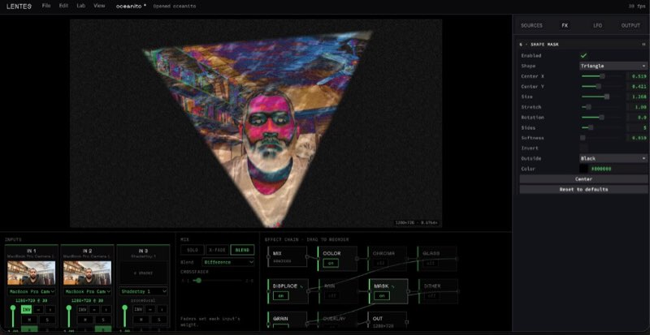

# LENTES



LENTES — Laboratorio de experimentación nodal para transformación de espectros y señales — is a real-time video mixer in the [Luminode Studio](https://luminode.studio/) suite, with [GLOW](https://github.com/rafaelbecks/glow), [MUSGO](https://github.com/rafaelbecks/resonant-torus) and [ESPORA](https://github.com/rafaelbecks/espora).

Up to three sources are mixed on the GPU and sent through a reorderable chain of effects.

## Run

Cameras need localhost or https.

```sh
npm install
npm start
```

Open http://127.0.0.1:8010/. The [Luminode Studio](https://github.com/rafaelbecks/luminode-studio-website) host can publish the canvas to Syphon or Spout.

## What it does

- **Sources.** Each strip takes a camera, a video or still image, a GLOW shader (Portal, Disco Sun, Balatro, Chroma gradients), or Shadertoy code pasted in the Shader Lab. Invert, flip, gain, saturation and hue apply to every source. A file can loop, and its width, height and position place it on the frame (drag it on the output).
- **Mix.** Solo, crossfade or blend, with mute and the blend modes normal, additive, multiply and difference.
- **Effects.** Color, chromatic aberration, glass, glass displacement, rain, shape mask, dither, grain and a color overlay. Drag a node to reorder the chain.
- **LFOs** drive sliders and switches while the frame is drawn.
- **Projects** are `.lentes` files. They remember the settings and a file's name; the video or image itself stays on disk.

LENTES is free software under GPL-3.0 or later. Third-party licenses are in NOTICE.md.
